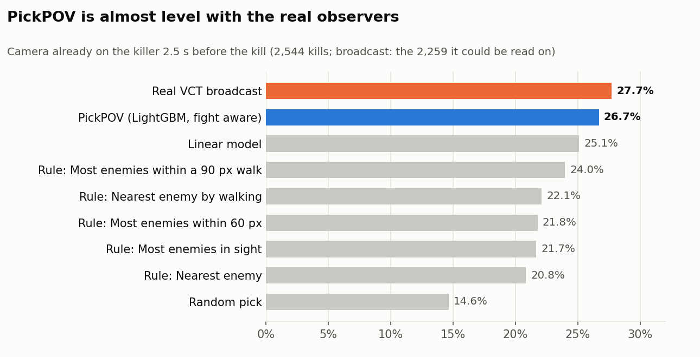
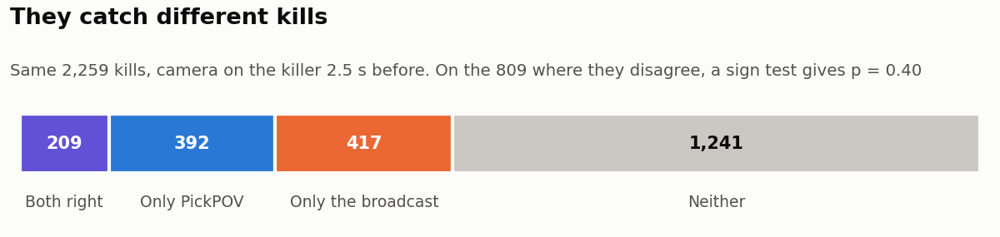
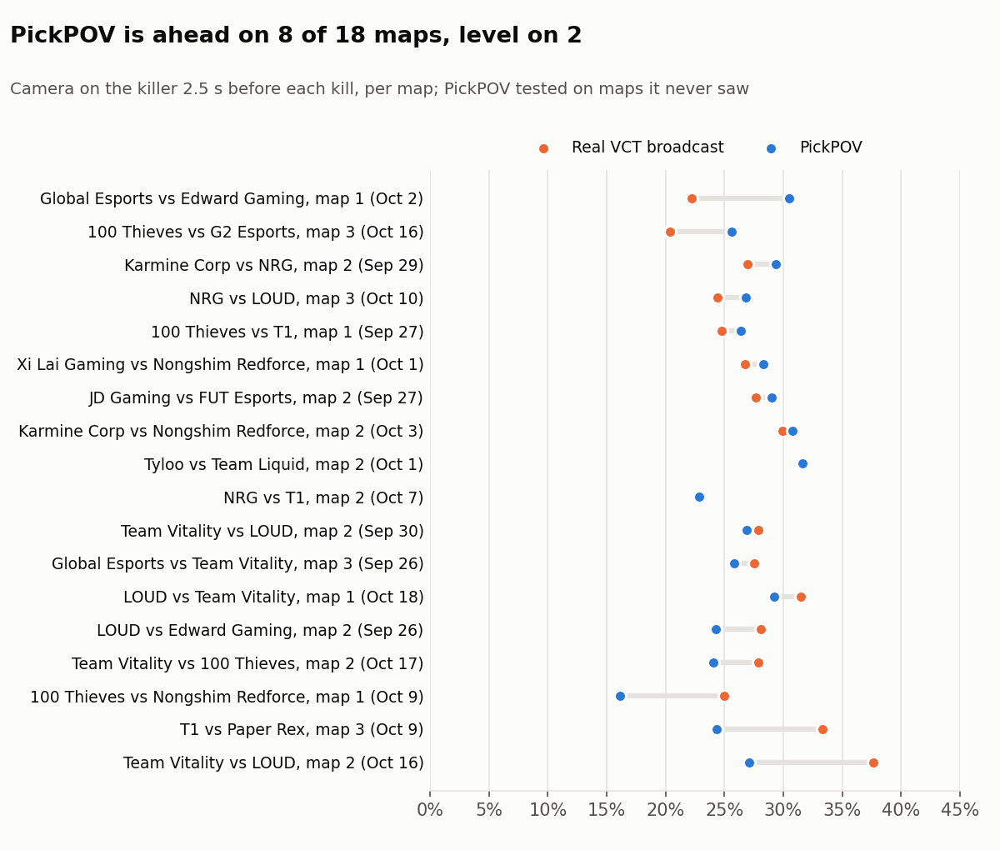
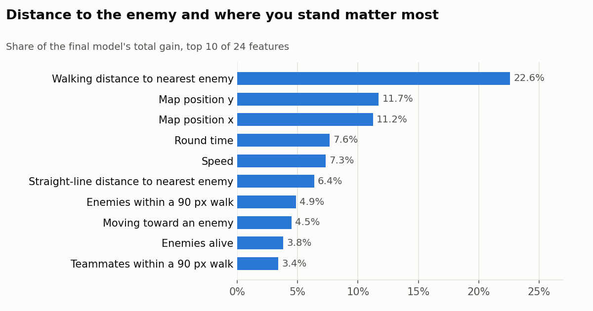

# PickPOV v1 results

**PickPOV picks the right player as often as the real VCT observers.** Two and a half seconds before a kill, PickPOV's camera is on the future killer 26.6% of the time, against 27.7% for the official broadcast on the same 2,259 kills. That gap is not statistically significant (sign test, p = 0.40). The two also catch different kills, so PickPOV is most useful as an assistant to a human observer.



## What was tested

- **Data:** all 18 Summit maps from VALORANT Champions 2026 Shanghai: 389 rounds and 2,606 kills. 2,544 of them are scored; the other 62 have no readable killer or no minimap frame 2.5 s earlier in the same round.
- **Task:** 2.5 seconds before each kill, pick one alive player to spectate. A pick is right if it is the player who gets the kill ("caught the killer"). Picking the victim instead gets partial credit ("caught the fight").
- **Why 2.5 s:** an observer needs time to switch, and the switch has to happen *before* the fight starts. At the moment of the kill, the real broadcast was on the killer only 45.0% of the time.
- **Fair testing:** the model is trained on 17 maps and tested on the 18th, for each of the 18 maps (leave-one-map-out). Every score below comes from a map the model never saw.
- **The broadcast:** who it was showing comes from the player name it displays, read once per second. Kills where that name couldn't be read are left out of the broadcast's score.

## Every picker

| Picker | Caught the killer | Caught the fight |
| --- | --- | --- |
| Random pick | 14.6% | 29.0% |
| Rule: nearest enemy | 20.8% | 42.6% |
| Rule: most enemies in sight | 21.7% | 45.1% |
| Rule: most enemies within 60 px | 21.8% | 46.7% |
| Rule: nearest enemy by walking | 22.1% | 45.7% |
| Rule: most enemies within a 90 px walk | 24.0% | 50.9% |
| Linear model | 25.1% | 51.0% |
| **PickPOV (LightGBM, fight aware)** | **26.7%** | **53.0%** |
| Real VCT broadcast | 27.7% | 55.2% |

Rules score 2,544 kills; the broadcast scores the 2,259 where its name label was readable. On the model's own feature table the best rule scores 24.9%, so the model's lead over hand-written rules is about 2 points.

What made the difference, in order:
1. **Walls and doors.** Measuring "close to an enemy" as walking distance around walls instead of a straight line took the best rule from 21.8% to 24.0%.
2. **Learning instead of rules.** A linear model on 24 features only tied the best rule.
3. **Combinations and hot spots.** LightGBM learns situations like "close to an enemy *and* in this part of the map", and training it to rank the killer first and the victim second (fight aware) gave the best result.

## Head-to-head with the observers



On exactly the same 2,259 kills, PickPOV was right on 601 (26.6%) and the broadcast on 626 (27.7%). They disagreed on 809 kills, and PickPOV won 392 of those against the broadcast's 417: a split that close happens by chance 40% of the time. Only 209 kills were caught by both, so together they would have been on the killer for 1,018 kills (45%).

## Map by map



PickPOV is ahead on 8 maps, behind on 8 and level (within half a point) on 2. The gaps run both ways and are large: from 8.3 points ahead (Global Esports vs Edward Gaming, 30.5% vs 22.2%) to 10.5 points behind (Team Vitality vs LOUD on Oct 16, 27.1% vs 37.6%). With only 86–253 kills per map, a single map can't show which picker is better; the pooled head-to-head above is the fair comparison. Per map, PickPOV is scored on every kill and the broadcast only on kills where its label was readable.

## What the model looks at



Walking distance to the nearest enemy matters most, followed by the player's position on the map, which is how the model learns Summit's hot spots. Agent role barely matters.

## Health doesn't help

Adding each player's HP, read from the VCT player cards, scored 26.6%: no better than without it (26.7%). Two and a half seconds before a kill, the fight usually hasn't started, so most players are still at full health. That's useful: the model only needs the minimap, kill feed and round timer, which every Valorant spectator view has, not the VCT-only player cards.

## Limits

- **One map, one event.** Every result is Summit at Champions 2026. Other maps need their own floor map and doors.
- **Reading errors.** Positions are found for 77–92% of alive players per frame, and icons blink out during fights. Boxes, small cover and height (stairs, ledges) are not in the floor map.
- **The broadcast score is a floor.** Observers can see things PickPOV can't (sound, crosshair placement, comms), but they also follow storylines and replays, so "caught the killer" doesn't capture everything a good observer does.

## Reproduce

```
python scripts/evaluate_pickers.py --lead 0 2.5   # rules and broadcast -> data/results/pickers.csv
python scripts/train_lgbm.py                      # models, leave-one-map-out -> data/results/lgbm*.txt/csv
python scripts/make_report.py                     # charts -> docs/figures/
```

Results files: `data/results/pickers.csv` (per map, per rule), `data/results/lgbm.txt` (model summary), `data/results/lgbm_per_map.csv` and `data/results/lgbm_importance.csv`.
